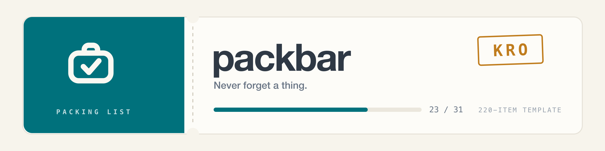

<div align="center">

<picture>
  <source media="(prefers-color-scheme: dark)" srcset=".github/banner-dark.png">
  
</picture>

### Never forget a thing.

The packing list you actually check off: a **220-item template**, built for
sharing, printed cleanly at the end.

`Next.js 16` · `React 19` · `Postgres` · `Drizzle` · `Better Auth` · `Tailwind 4`

</div>

---

## Why another packing list

Because most of them are either an empty notes app or an app that wants to tell
you how to travel. packbar does exactly one thing: a list you tick off — and it
brings a template where crossing things out is faster than remembering them.

Every list is a boarding pass: cover, destination code, countdown, progress,
perforation. What's in the suitcase gets struck through. The rest stays visible.

## What it does

| | |
|---|---|
| **220-item template** | 26 categories from passport to power bank, with subcategories |
| **Presets** | Beach, road trip, camping, city break, winter, with kids, with pets — or everything |
| **Quantity suggestions** | Derived from the trip dates: 7 nights → 8× underwear, 5× t-shirt, 2× pyjamas |
| **Share by link** | View-only or collaborative. Whoever has the link ticks along — no account needed |
| **Live sync** | Shared lists stay in step while two people pack at once |
| **Last minute** | Items that only go in on departure day. On the trip date you get a mail with what's still open |
| **Weather at the destination** | Enter a destination and packbar pulls the forecast and warns about rain |
| **Import** | Paste a list from a chat or your notes — bullets, numbering, checkboxes and `3x` are all recognised |
| **People** | Assign items to people and filter by them |
| **Drag & drop** | Reorder items and categories, including across categories |
| **Print view** | Two columns, black and white, travels along as a sheet of paper |
| **Custom covers** | 15 curated photos, three gradients — or upload your own |
| **PWA & dark mode** | Installable, offline-capable, light and dark |

## Getting started

```bash
docker compose up -d      # Postgres on port 5435
pnpm install
pnpm db:migrate
pnpm seed                 # optional: dev account + example list
pnpm dev                  # http://localhost:4100
```

Environment variables go in `.env`, template in `.env.example`. Without
`SMTP_HOST` mails land in the server log instead of an inbox — good enough for
local development.

More on structure, tests and deployment: **[DEVELOPMENT.md](DEVELOPMENT.md)**

## Design

Boarding pass as the guiding idea: perforation instead of a hairline,
destination code as a ticket stamp, monospaced digits for anything countable.
Bricolage Grotesque for headings, Instrument Sans for body, Space Mono for meta.

No native scrollbars anywhere, no `window.confirm`. Every UI string goes through
`next-intl` — German and English are both maintained.

> **Note on language:** the app ships German and English; source comments are in
> German. The docs are English.

## License

MIT. Cover photos from [Unsplash](https://unsplash.com), photographers credited
in [`public/covers/ATTRIBUTION.md`](public/covers/ATTRIBUTION.md).
